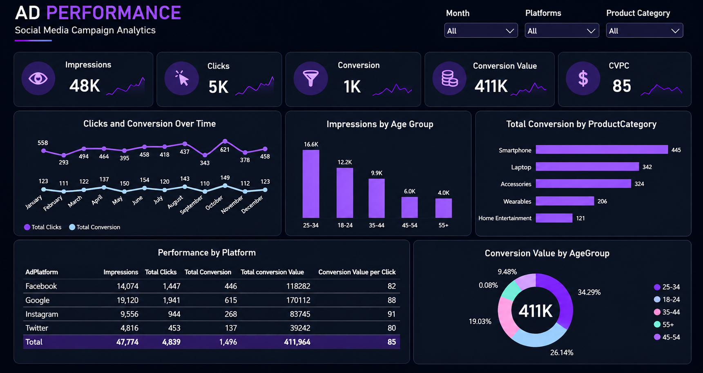

# AD Marketing | Campaign Performance Analytics

## Project Overview

A Power BI dashboard project focused on analyzing digital advertising campaign performance through interactive data visualizations.

This portfolio showcases the dashboard design and analytical insights from a training project.

## Tools & Skills

- Microsoft Power BI
- Marketing Analytics
- KPI Reporting
- Data Visualization
- Interactive Dashboard Design

## Key Performance Indicators

- Total Impressions
- Total Clicks
- Total Conversions
- Total Conversion Value
- Conversion Value per Click (CVPC)

## Dashboard Analysis

- Monthly clicks and conversion trends
- Impressions by age group
- Conversions by product category
- Performance comparison across advertising platforms
- Conversion value distribution by age group

## Dashboard Preview

## Project Disclaimer

This project was developed for educational and portfolio purposes. The original Power BI project file and training dataset are not publicly shared to respect the training provider's intellectual property and data usage
